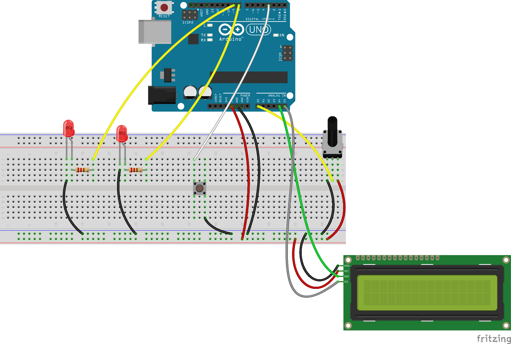
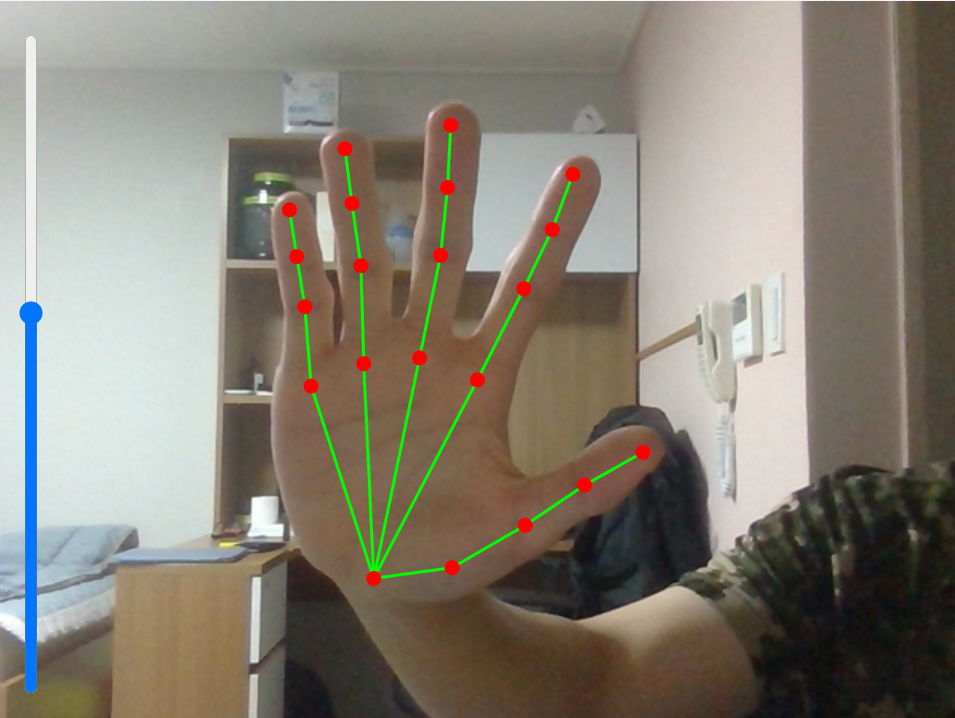
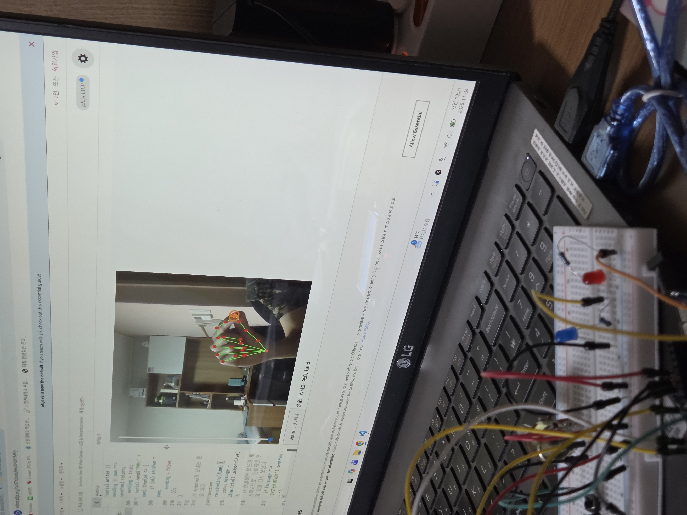
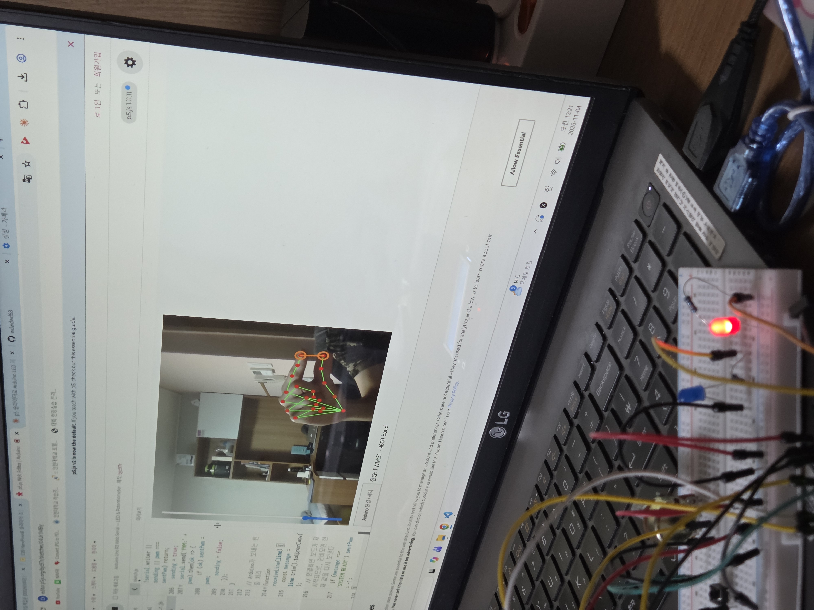
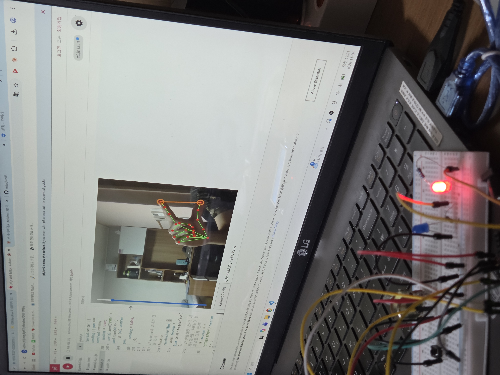

# Pinch Dimmer — 손가락 간격으로 LED 밝기 조절

웹캠으로 손을 인식해 **엄지와 검지 사이의 간격**으로 p5.js 슬라이더를 움직이고, 그 값을 Web Serial로 Arduino에 보내 **D9에 연결된 LED 밝기**를 PWM으로 조절합니다. 가운데 손가락을 접으면 조절이 시작되고, 펴면 그 밝기로 고정됩니다.

### ▶ [p5.js 스케치](https://editor.p5js.org/bjc97r/sketches/04Ur1M6iy)

---

## 1. 시스템 구성

1. **Web Serial 스케치**: `PWM:0~255` 명령으로 D9 밝기 전송. 통신을 맡는 `serial-helper.js`는 수정 없이 그대로 사용
2. **손 인식 스케치**: ml5 `handPose`로 손 관절 21개를 찾아 빨간 점과 초록 선으로 표시
3. **세로 슬라이더 스케치**: 가운데 손가락을 접으면 조절 모드, 엄지–검지 간격으로 슬라이더(0~100) 조절

```
웹캠 → ml5 handPose (관절 21개)
     → 가운데 손가락을 접었나? (잡기 모드)
     → 엄지(4)–검지(8) 거리 ÷ 손바닥 길이 → 슬라이더 0~100
     → map(0~100 → 0~255) → "PWM:173\n" (9600 baud)
     → Arduino analogWrite(9, 173) → LED 밝기, LCD 표시
```

## 2. 연결도



| Arduino 핀 | 연결 | 설명 |
|---|---|---|
| **~9** | 220Ω → 빨강 LED(+) → GND | **PWM 출력**: 손가락 간격으로 밝기 조절 |
| 8 | 220Ω → 노랑 LED(+) → GND | 디지털 ON/OFF |
| 2 | 택트 스위치 → GND | `INPUT_PULLUP`이라 저항 없이 연결, 누르면 FALLING 인터럽트 |
| A0 | 가변저항 가운데 다리 | 양 끝 다리는 5V, GND |
| A4 / A5 | LCD SDA / SCL | Uno의 I2C 핀 |
| 5V / GND | 브레드보드 + / − 레일 | LCD, 가변저항 전원 |

---

## 3. 스케치



- **손 인식 표시**: 관절 21개를 빨간 점으로, 뼈대를 초록 선으로 그립니다.
- **조절 모드 표시**: 가운데 손가락을 접으면 엄지 끝과 검지 끝을 주황색 선과 원으로 잇습니다.
- **세로 슬라이더**: 손가락 간격(0~100)이 슬라이더에 나타납니다. 손 인식이 안 될 때는 마우스로 움직여도 같은 값이 전송됩니다.
- **연결 버튼과 상태**: 캔버스 아래 버튼으로 Arduino에 연결하고, 옆에 연결 상태와 마지막으로 보낸 명령(`전송: PWM:173`)이 표시됩니다.

### 핵심 코드 ① 잡기 모드와 손가락 간격

```js
// 가운데 손가락 끝(12)이 손바닥 길이보다 손목에 가까우면 → 접었다고 판단
function isGrabMode(hs) {
  ...
  let palmLength   = dist(ks[0].x, ks[0].y, ks[9].x, ks[9].y);
  let grabDistance = dist(ks[0].x, ks[0].y, ks[12].x, ks[12].y);
  if (grabDistance > palmLength) return false;
  return true;
}

// 엄지-검지 거리 ÷ 손바닥 길이 → 0~100 (카메라와의 거리와 무관)
let s = round(100 * (v / p)) - 15;
return constrain(s, 0, 100);
```

### 핵심 코드 ② 손 인식 시작과 거울 화면

```js
handPose = await ml5.handPose();
if (handPose.ready) await handPose.ready;   // 모델이 준비된 뒤에 인식 시작
handPose.detectStart(video, gotHands);

// draw(): 카메라 영상과 손 표시를 함께 좌우 반전
push();
translate(width, 0);
scale(-1, 1);
image(video, 0, 0, width, height);
drawSkeletons(hands);
drawKeyPoints(hands);
if (adjustMode) drawConnectedLine(hands);
pop();
```

### 핵심 코드 ③ 슬라이더 → PWM → 아두이노

```js
if (adjustMode) {
  let v = getNormalizedDistance(hands);
  smoothValue = lerp(smoothValue, v, 0.2);    // 실수 값으로 부드럽게 따라간 뒤
  slider.value(round(smoothValue));           // 슬라이더에는 반올림해서 넣기
}

function sendPwm() {                          // 값이 바뀌었을 때만, 한 번에 하나씩
  const pwm = round(map(sliderValue, 0, 100, 0, 255));
  if (!serial || !serial.writer || sending || pwm === sentPwm) return;
  sending = true;
  serial.send('PWM:' + pwm).then(ok => { if (ok) sentPwm = pwm; sending = false; });
}
```

### 핵심 코드 ④ 아두이노: 받은 값을 D9에 출력

```cpp
else if (strncmp(command, "PWM:", 4) == 0) {
  int value;
  if (parsePWM(command, value)) setPWM(value);   // 숫자 0~255만 허용
  else Serial.println("Invalid PWM (0~255)");
}

void setPWM(int value) {
  value = constrain(value, 0, 255);
  if (pwmValue == value) return;
  pwmValue = value;
  analogWrite(PWM_LED_PIN, pwmValue);           // PWM_LED_PIN = 9
  Serial.print("PWM: "); Serial.println(pwmValue);
}
```

전체 코드: [p5/sketch.js](p5/sketch.js) · [p5/serial-helper.js](p5/serial-helper.js) · [arduino/pinch_led_dimmer/pinch_led_dimmer.ino](arduino/pinch_led_dimmer/pinch_led_dimmer.ino)

---

## 4. 데모

| 손가락을 붙였을 때 (PWM 0) | 반쯤 벌렸을 때 | 활짝 벌렸을 때 (PWM 255) |
|---|---|---|
|  |  |  |

https://github.com/user-attachments/assets/bc591d2a-1e54-4a1a-b4c6-ca6c883c3ee6

---

## 5. 설명

### 1) 손 인식
ml5.js의 `handPose`는 영상 프레임마다 손 관절 21개(0 손목, 4 엄지 끝, 8 검지 끝, 9 중지 시작점, 12 중지 끝 …)의 좌표를 돌려줍니다. `async setup()`에서 모델을 불러오고, 모델이 준비된 뒤 `detectStart()`로 인식 결과를 계속 `hands`에 받습니다. 화면은 거울처럼 보이도록 영상과 손 표시를 함께 좌우로 뒤집어 그립니다.

### 2) 잡기(grab) 모드
손이 보이기만 하면 값이 바뀌면, 손을 내리거나 화면 밖으로 빼는 동안에도 밝기가 바뀌어 버립니다. 그래서 **가운데 손가락을 접었을 때만** 조절합니다. 손목→중지 끝 거리가 손바닥 길이(손목→중지 시작점)보다 짧으면 접은 것으로 봅니다. 가운데 손가락을 펴면 그 값이 고정됩니다.

### 3) 간격을 비율로 바꾸기
엄지–검지 거리를 픽셀 그대로 쓰면 손을 카메라에 가까이 대기만 해도 값이 커집니다. 같은 손에서 거의 변하지 않는 손바닥 길이로 나누면 카메라와의 거리와 상관없는 값이 됩니다. 100을 곱하고 15를 빼서, 손가락을 붙였을 때 0에 가깝고 활짝 벌렸을 때 100이 되도록 맞췄습니다.

### 4) 슬라이더 값을 PWM으로
슬라이더는 0\~100이고 `analogWrite`는 0\~255를 받으므로, `map(sliderValue, 0, 100, 0, 255)`로 바꾼 뒤 반올림해 `PWM:값`으로 보냅니다.

### 5) 시리얼 통신 규칙 (9600 baud, 한 줄 단위)

| 방향 | 메시지 | 의미 |
|---|---|---|
| p5 → Arduino | `PWM:0` ~ `PWM:255` | D9 밝기 |
| p5 → Arduino | `ON` / `OFF` | D8 LED 켜기 / 끄기 |
| Arduino → p5 | `PWM: 173` | D9에 실제로 적용한 값 |
| Arduino → p5 | `LED: ON` / `LED: OFF` | D8 상태 |
| Arduino → p5 | `POT: 512` | 가변저항 값 (5 이상 변했을 때만) |
| Arduino → p5 | `System Ready` | 보드 시작 → p5가 현재 밝기를 다시 보냄 |

### 6) 아두이노: TaskScheduler로 나눠서 처리
아두이노 코드는 `delay()` 없이 작업 4개를 주기별로 돌립니다. 버튼 이벤트(10ms), 가변저항 측정(100ms), 시리얼 명령 처리(20ms), LCD 갱신(100ms)입니다. 시리얼 작업은 글자를 모으다가 줄바꿈이 오면 명령으로 해석하고, `PWM:` 뒤의 숫자가 0~255인지 검사한 뒤 `analogWrite(9, 값)`을 실행합니다. 덕분에 손으로 값을 빠르게 보내도 버튼과 LCD가 멈추지 않습니다.

### 7) PWM으로 밝기 만들기
Uno는 진짜 아날로그 전압을 내지 못합니다. `analogWrite(9, v)`는 D9를 약 490Hz로 켰다 껐다 하면서, 한 주기 중 켜져 있는 비율을 `v / 255`로 정합니다.

---

## 6. 고찰

### 잘 된 점
수업에서 따로 만든 코드(손 인식, 슬라이더, 시리얼 통신)를 "슬라이더"라는 중간값으로 이어 붙였습니다. 입력(손)은 슬라이더만 바꾸고, 출력(시리얼/LED)은 슬라이더 값만 읽기 때문에 각 부분을 따로 고치고 시험하기 쉬웠습니다. 손 인식이 안 될 때는 마우스로 슬라이더를 움직여 통신과 회로만 따로 확인할 수 있었습니다.

### 어려웠던 점과 해결
- **카메라는 나오는데 손에 점이 찍히지 않음**: 사용한 p5 1.11에서는 `await ml5.handPose()`가 모델 로딩을 기다리지 않습니다. 모델이 없는 상태에서 `detectStart()`가 실행되어 인식 반복이 오류 한 번으로 멈춰 버렸습니다. `await handPose.ready`로 모델이 준비된 뒤에 인식을 시작하도록 고쳤습니다.
- **손이 좌우 반대로 표시됨**: `flipped: true` 옵션이 p5 버전에 따라 영상과 손 좌표 중 한쪽에만 적용되어 점이 반대편에 찍혔습니다. 옵션을 빼고, 영상과 손 표시를 같은 좌표계에서 직접 뒤집어 해결했습니다.
- **슬라이더가 목표값까지 가지 않음**: 수업 코드의 `slider.value(c + 0.05*(v-c))`는 슬라이더 단위가 1이라, 차이가 10보다 작으면 더하는 양이 0.5보다 작아 반올림되면서 제자리에 머뭅니다. 실수 변수 `smoothValue`로 따라간 뒤 반올림해서 넣도록 고쳤습니다.
- **손을 내릴 때 밝기가 바뀜**: 가운데 손가락을 접었을 때만 조절하는 잡기 모드로 해결했습니다.
- **연결 직후 첫 값이 반영되지 않음**: 포트를 열면 Uno가 재시작되어 그 사이에 보낸 값이 사라집니다. 아두이노가 시작할 때 보내는 `System Ready`를 받으면 현재 값을 다시 보내도록 했습니다.
